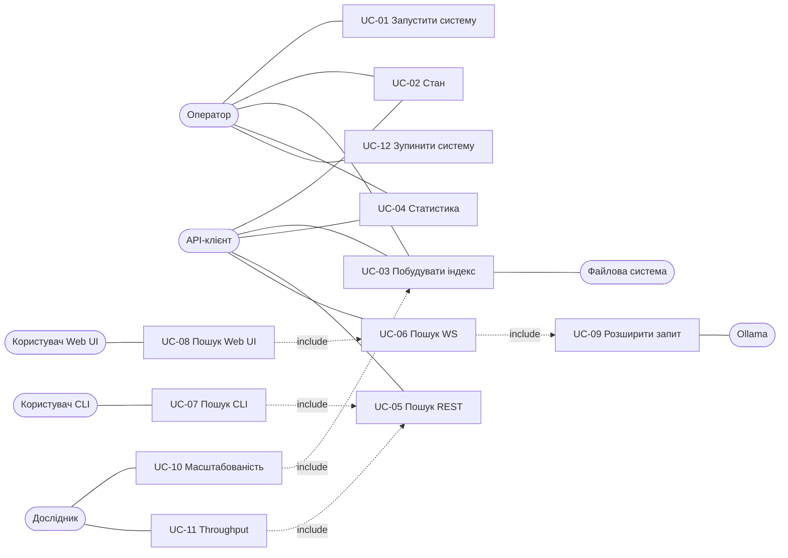
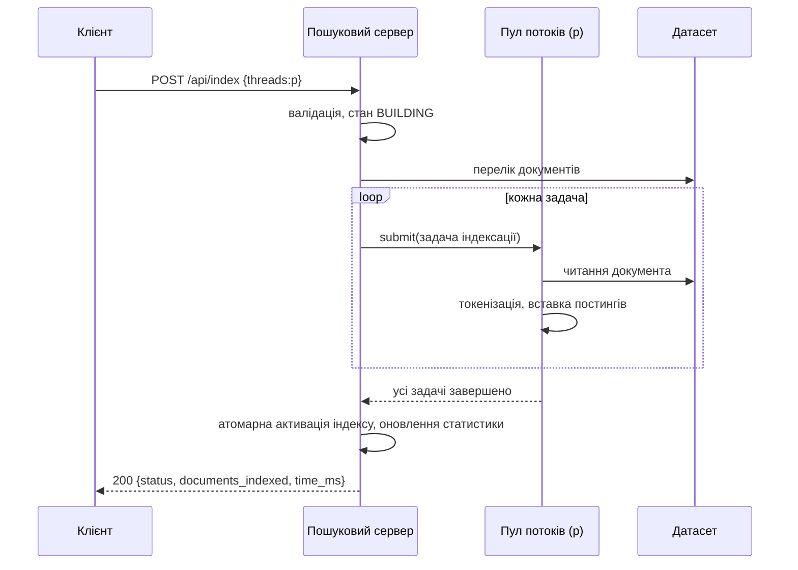
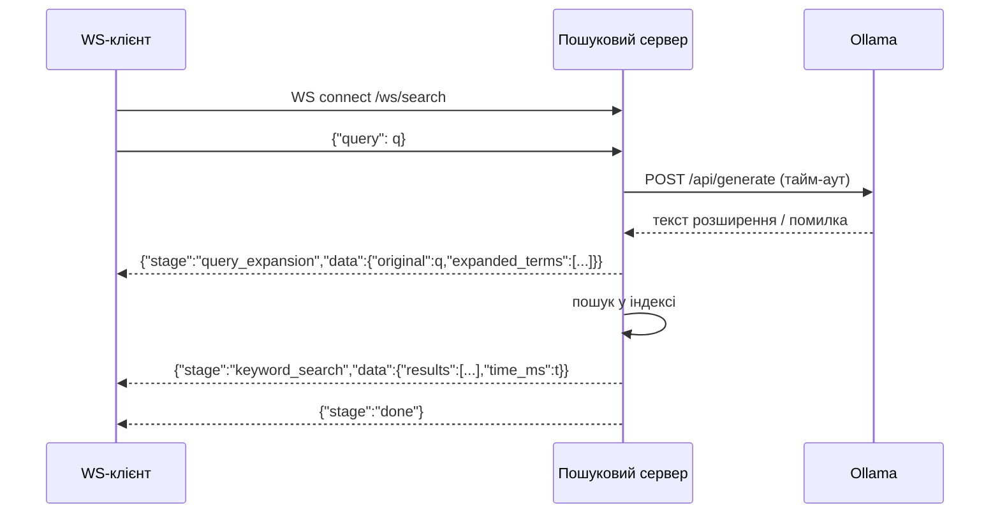

# 04. Варіанти використання і поведінка системи

## 4.1. Актори

| ID | Актор | Тип | Опис |
|---|---|---|---|
| ACT-USR | Користувач Web UI | Первинний | Шукає документи через браузер, бачить етапи пайплайну |
| ACT-CLI | Користувач CLI | Первинний | Шукає з командного рядка |
| ACT-OPS | Оператор | Первинний | Запускає систему, будує індекс, переглядає статистику і стан |
| ACT-BEN | Дослідник | Первинний | Запускає бенчмарки, отримує таблиці та графіки |
| ACT-API | Зовнішній API-клієнт (у т.ч. автоматичний перевіряльник) | Первинний | Звертається до REST/WS напряму |
| ACT-OLL | Ollama | Вторинний (система) | Генерує розширення запиту |
| ACT-FS | Файлова система датасету | Вторинний (система) | Джерело документів |

## 4.2. Перелік варіантів використання

| ID | Назва | Тип | Актори | FR / NFR |
|---|---|---|---|---|
| UC-01 | Запустити систему | Первинний | ACT-OPS | NFR-011, NFR-012, NFR-024, FR-034 |
| UC-02 | Перевірити стан системи | Первинний | ACT-OPS, ACT-API | FR-001, FR-002, NFR-010 |
| UC-03 | Побудувати індекс | Первинний | ACT-OPS, ACT-API, ACT-BEN; ACT-FS | FR-003…FR-009, FR-036…FR-042, NFR-004…NFR-006 |
| UC-04 | Переглянути статистику | Первинний | ACT-OPS, ACT-API | FR-010, FR-011 |
| UC-05 | Шукати через REST | Первинний | ACT-API | FR-012…FR-018, FR-035, FR-028, FR-043, NFR-025 |
| UC-06 | Шукати з потоковою передачею етапів (WebSocket) | Первинний | ACT-API | FR-022…FR-027, FR-020, FR-028 |
| UC-07 | Шукати через CLI | Первинний | ACT-CLI | FR-029, FR-030 |
| UC-08 | Шукати через Web UI | Первинний | ACT-USR | FR-031…FR-034 |
| UC-09 | Розширити запит | Вторинний (include) | ACT-OLL | FR-019, FR-021, NFR-008, NFR-020 |
| UC-10 | Виміряти масштабованість побудови | Первинний | ACT-BEN | NFR-001, NFR-002, NFR-022, NFR-023 |
| UC-11 | Виміряти throughput за кількістю клієнтів | Первинний | ACT-BEN | NFR-003, NFR-023, FR-028 |
| UC-12 | Зупинити систему | Первинний | ACT-OPS | NFR-026, FR-040 |

Зв'язки: UC-06 «include» UC-09; UC-07 «include» UC-05; UC-08 «include» UC-06; UC-10 «include» UC-03; UC-11 «include» UC-05 (або UC-06, OQ-17).

UML-діаграма use case для записки (DEL-03) будується з цієї таблиці.

---

## UC-01. Запустити систему
- **Актори:** ACT-OPS.
- **Передумови:** Встановлено Docker і Docker Compose; репозиторій склоновано; датасет розміщено згідно з README (OQ-23).
- **Основний потік:**
  1. Оператор виконує `docker compose up` у корені репозиторію.
  2. Compose запускає сервіс Ollama і сервіс пошукового сервера.
  3. Сервер зчитує конфігурацію і валідує її (NFR-019).
  4. Сервер починає приймати HTTP і WebSocket.
  5. `GET /api/health` повертає 200.
  6. Модель Ollama стає доступною без ручних дій (NFR-024; спосіб — OQ-13); health повертає `ollama: true`.
  7. Якщо `INDEX_ON_START=true` (значення за замовчуванням у `docker-compose.yml`), сервер у фоні запускає побудову індексу (UC-03) з `DEFAULT_INDEX_THREADS`; до її завершення пошук повертає 409 `index_not_ready`.
- **Альтернативні потоки:**
  - A1 (крок 6): модель ще завантажується → health повертає `ollama: false`, доки модель не стане доступною в межах `READINESS_TIMEOUT_S`.
- **Потоки винятків:**
  - E1 (крок 3): некоректна конфігурація → сервер завершується з кодом ≠ 0 і повідомленням; compose показує помилку.
  - E2: порт зайнятий → сервіс не стартує; повідомлення в лозі.
- **Постумови:** Обидва сервіси працюють; індекс будується автоматично, якщо `INDEX_ON_START=true`, інакше не побудовано (FR-011, FR-018).
- **FR/NFR:** NFR-011, NFR-012, NFR-019, FR-001, FR-034.

## UC-02. Перевірити стан системи
- **Актори:** ACT-OPS, ACT-API.
- **Передумови:** Сервер запущено.
- **Основний потік:**
  1. Актор надсилає `GET /api/health`.
  2. Сервер перевіряє доступність Ollama з тайм-аутом.
  3. Сервер повертає 200 `{ "status": "ok", "ollama": true }`.
- **Альтернативні потоки:**
  - A1 (крок 2): Ollama недоступна або тайм-аут → 200 `{ "status": "ok", "ollama": false }`.
  - A2: триває побудова індексу → відповідь та сама (NFR-010).
- **Потоки винятків:** E1: сервер не запущено → з'єднання відхилено (поза контролем системи).
- **Постумови:** Без змін стану.
- **FR/NFR:** FR-001, FR-002, NFR-010.

## UC-03. Побудувати індекс
- **Актори:** ACT-OPS, ACT-API, ACT-BEN; вторинний ACT-FS.
- **Передумови:** Сервер запущено; датасет доступний.
- **Основний потік:**
  1. Актор надсилає `POST /api/index` з `{ "threads": p }`.
  2. Сервер валідує тіло (FR-007).
  3. Сервер позначає стан «побудова триває».
  4. Сервер виявляє документи в каталозі датасету.
  5. Задачі індексації подаються у власний пул з p потоків (FR-006).
  6. Потоки зчитують, токенізують документи і вносять постинги в новий індекс.
  7. Після завершення всіх задач новий індекс атомарно стає активним (FR-008); статистика оновлюється.
  8. Сервер повертає 200 `{ "status": "ok", "documents_indexed": n, "time_ms": t }`.
- **Альтернативні потоки:**
  - A1 (крок 1): `threads` відсутній → використовується значення за замовчуванням (FR-004).
  - A2 (крок 6): документ не вдалося прочитати → документ пропущено, запис у лозі; побудова продовжується (FR-003, OQ-19).
  - A3 (крок 4): каталог порожній → 200, `documents_indexed: 0` (FR-003, OQ-22).
- **Потоки винятків:**
  - E1 (крок 2): невалідний `threads` або JSON → 400; стан без змін (FR-007).
  - E2 (крок 3): побудова вже триває → 409 `index_build_in_progress` (FR-009).
  - E3 (крок 4): каталог відсутній/недоступний → 500 `dataset_unavailable`; попередній індекс залишається активним (FR-003).
  - E4 (крок 6): виняток у задачі індексації (не помилка читання) → решта задач завершується, побудова відповідає 500 `index_build_failed`; попередній індекс залишається активним; наступна побудова можлива (FR-039, FR-042).
- **Постумови:** Успіх — активний новий індекс, статистика оновлена. Невдача — активний попередній індекс (або відсутній).
- **FR/NFR:** FR-003…FR-010, FR-036…FR-042, NFR-004…NFR-006.

## UC-04. Переглянути статистику
- **Актори:** ACT-OPS, ACT-API.
- **Передумови:** Сервер запущено.
- **Основний потік:** 1. `GET /api/stats`. 2. 200 з `documents`, `index_build_time_ms`, `threads_used` останньої успішної побудови.
- **Альтернативні потоки:** A1: побудов ще не було → нулі (FR-011). A2: триває побудова → значення попередньої успішної побудови.
- **Потоки винятків:** —
- **Постумови:** Без змін.
- **FR/NFR:** FR-010, FR-011.

## UC-05. Шукати через REST
- **Актори:** ACT-API.
- **Передумови:** Сервер запущено.
- **Основний потік:**
  1. Клієнт надсилає `POST /api/search` з `{ "query": q, "mode": "keyword" }`.
  2. Сервер валідує запит (FR-016).
  3. Сервер нормалізує запит і шукає в активному індексі (FR-013); чи застосовується розширення — OQ-02 (пропозиція: ні).
  4. Сервер ранжує (FR-014), формує snippet (FR-015).
  5. 200 `{ "results": [...], "time_ms": t }`.
- **Альтернативні потоки:**
  - A1 (крок 3): немає збігів → `results: []` (FR-017).
  - A2 (крок 3): триває перебудова → пошук у попередньому індексі (FR-035).
  - A3: одночасно працюють інші клієнти → обробка паралельна (FR-028).
- **Потоки винятків:**
  - E1 (крок 2): невалідний запит → 400 (FR-016).
  - E2 (крок 3): індексу немає → 409 `index_not_ready` (FR-018).
  - E3: перевищено `MAX_CONCURRENT_CONNECTIONS` → 503 `server_busy` (NFR-025).
  - E4: невідомий шлях / метод / завелике тіло → 404 / 405 / 413 (FR-043).
- **Постумови:** Індекс не змінено.
- **FR/NFR:** FR-012…FR-018, FR-028, FR-035, NFR-013.

## UC-06. Шукати з потоковою передачею етапів (WebSocket)
- **Актори:** ACT-API (у т.ч. Web UI як клієнт).
- **Передумови:** Сервер запущено.
- **Основний потік:**
  1. Клієнт відкриває з'єднання `/ws/search`.
  2. Клієнт надсилає `{ "query": q }`.
  2а. Сервер валідує повідомлення і перевіряє, що активний індекс існує.
  3. Сервер виконує UC-09 (розширення).
  4. Сервер надсилає `query_expansion` з `original` і `expanded_terms`.
  5. Сервер шукає за початковими і розширеними термами (FR-020).
  6. Сервер надсилає `keyword_search` з `results` і `time_ms`.
  7. Сервер надсилає `done`.
  8. Клієнт може надіслати наступний запит (повтор з кроку 2) або закрити з'єднання (P, OQ-12).
- **Альтернативні потоки:**
  - A1 (крок 3): Ollama недоступна/тайм-аут/некоректна відповідь → `expanded_terms: []`, далі крок 5 (FR-021).
  - A2: кілька сесій одночасно → кожна отримує лише свої події (FR-028).
- **Потоки винятків:**
  - E1 (крок 2а): невалідне повідомлення → подія `error`, з'єднання відкрите (FR-027).
  - E2 (крок 2а): індексу немає → лише подія `error` `index_not_ready`, без `query_expansion` і без виклику Ollama (FR-018).
  - E3: клієнт закрив з'єднання під час пайплайну → сервер припиняє надсилання для цієї сесії, звільняє ресурси; інші сесії не зачеплено (NFR-009).
  - E4 (крок 2): новий запит до завершення попереднього в тій самій сесії → подія `error` `pipeline_busy` (OQ-12).
- **Постумови:** Індекс не змінено.
- **FR/NFR:** FR-018, FR-020…FR-028, NFR-008, NFR-009.

## UC-07. Шукати через CLI
- **Актори:** ACT-CLI.
- **Передумови:** Сервер запущено; CLI зібрано/доступно (OQ-16).
- **Основний потік:**
  1. Користувач виконує `./search "запит"`.
  2. CLI виконує UC-05.
  3. CLI друкує результати (doc_id, score, snippet), код виходу 0.
- **Альтернативні потоки:** A1: немає результатів → повідомлення, код 0.
- **Потоки винятків:** E1: немає аргументу → usage, код ≠ 0. E2: сервер недоступний → помилка, код ≠ 0. E3: сервер повернув 4xx/5xx → текст помилки, код ≠ 0.
- **Постумови:** —
- **FR/NFR:** FR-029, FR-030.

## UC-08. Шукати через Web UI
- **Актори:** ACT-USR.
- **Передумови:** Система запущена (UC-01).
- **Основний потік:**
  1. Користувач відкриває адресу Web UI (FR-034).
  2. Вводить запит, натискає кнопку.
  3. UI виконує UC-06.
  4. UI показує етап `query_expansion` і розширені терміни.
  5. UI показує етап `keyword_search` і список результатів.
  6. UI позначає пайплайн завершеним після `done`.
- **Альтернативні потоки:** A1 (крок 4): `expanded_terms` порожній → «розширення недоступне». A2 (крок 5): результатів немає → повідомлення.
- **Потоки винятків:** E1 (крок 2): порожній запит → не надсилається, підказка (FR-031). E2: подія `error` (у т.ч. `index_not_ready`, якщо індекс не побудовано) → текст `data.message` (FR-032). E3: з'єднання не встановлено або обірвалося → повідомлення про недоступність сервера (FR-032, AC-032.3).
- **Постумови:** —
- **FR/NFR:** FR-031…FR-034.

## UC-09. Розширити запит (include)
- **Актори:** ACT-OLL.
- **Передумови:** Запущено UC-06.
- **Основний потік:**
  1. Сервер формує промпт з запитом і надсилає на `/api/generate` Ollama з тайм-аутом.
  2. Ollama повертає текст.
  3. Сервер виділяє терміни, нормалізує, видаляє дублікати і терми запиту, обмежує кількість (FR-019).
- **Альтернативні потоки:** A1: недоступність, тайм-аут або відсутність придатних термів → порожній список (FR-021).
- **Потоки винятків:** — (усі збої обробляються A1).
- **Постумови:** Список `expanded_terms` (можливо порожній).
- **FR/NFR:** FR-019, FR-021, NFR-008, NFR-020.

## UC-10. Виміряти масштабованість побудови
- **Актори:** ACT-BEN.
- **Передумови:** Система запущена; бенчмарковий датасет на місці (NFR-014).
- **Основний потік:**
  1. Дослідник запускає скрипт бенчмарку побудови.
  2. Скрипт фіксує параметри середовища (NFR-023).
  3. Для кожного p з набору: прогрів, потім R повторів UC-03 з `threads: p`.
  4. Скрипт рахує медіану, min/max, S(p), E(p), пікову пам'ять.
  5. Скрипт зберігає таблицю і будує графік «час vs потоки» (DEL-07).
- **Альтернативні потоки:** A1: побудова повернула помилку → вимір позначено невдалим, скрипт завершується з кодом ≠ 0.
- **Потоки винятків:** E1: health не 200 → скрипт не стартує вимірювання.
- **Постумови:** Таблиця і графік у каталозі результатів.
- **FR/NFR:** NFR-001, NFR-002, NFR-022, NFR-023.

## UC-11. Виміряти throughput за кількістю клієнтів
- **Актори:** ACT-BEN.
- **Передумови:** Індекс побудовано.
- **Основний потік:**
  1. Дослідник запускає скрипт навантаження.
  2. Для кожної кількості клієнтів K: прогрів, потім K одночасних клієнтів надсилають запити з фіксованого набору протягом заданого часу (OQ-17).
  3. Скрипт рахує throughput, частку помилок, медіану і p95 затримки.
  4. Скрипт зберігає таблицю і графік (DEL-08).
- **Альтернативні потоки:** A1: частка помилок > 0 → фіксується в таблиці і позначається.
- **Потоки винятків:** E1: health не 200 або індексу немає → скрипт не стартує.
- **Постумови:** Таблиця і графік.
- **FR/NFR:** NFR-003, NFR-023, FR-028.

---

## UC-12. Зупинити систему
- **Актори:** ACT-OPS.
- **Передумови:** Система запущена.
- **Основний потік:**
  1. Оператор виконує `docker compose down` (або `stop`).
  2. Сервер отримує SIGTERM і припиняє приймати нові з'єднання.
  3. Сервер закриває WS-сесії з кодом 1001.
  4. Побудова, якщо триває, переривається без активації нового індексу, а з'єднання її клієнта закривається без відповіді (P, OQ-32); пули потоків завершують роботу (FR-040, FR-041).
  5. Процес виходить з кодом 0 у межах `SHUTDOWN_TIMEOUT_MS`.
- **Альтернативні потоки:** A1: немає активних сесій і побудов → кроки 3–4 порожні.
- **Потоки винятків:** E1: завершення не вкладається в `SHUTDOWN_TIMEOUT_MS` → Docker надсилає SIGKILL (дефект, NFR-026 не виконано).
- **Постумови:** Процес зупинено; модель Ollama збережено в томі.
- **FR/NFR:** NFR-026, FR-040.

---

## 4.3. Діаграми послідовності (для DEL-05)

Нижче — нормативні послідовності для UC-03 і UC-06. Діаграми послідовності для решти UC (UC-01, UC-02, UC-04, UC-05, UC-07…UC-12) будуються з основних потоків вище в межах TCK-037, бо SRC-A вимагає sequence diagram для кожного use case.

