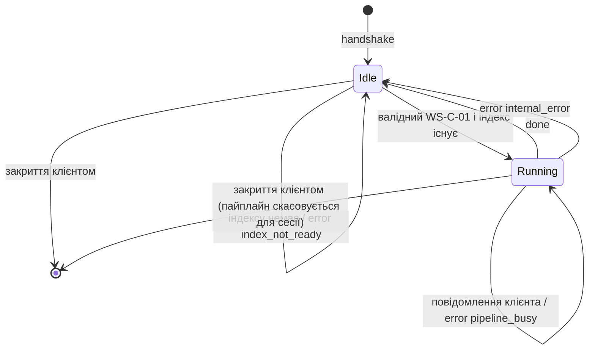

# 06. Специфікація API

Машиночитаний REST-контракт: `docs/specification/openapi.yaml` (OpenAPI 3.0.3). У разі розбіжності між цим документом і `openapi.yaml` пріоритет має цей документ, а розбіжність є дефектом специфікації.

Позначки: **[SRC-A]** — елемент фіксованого контракту курсової, змінювати не можна; **[P]** — запропоноване доповнення, очікує затвердження (посилання на OQ).

## 1. Перелік інтерфейсів

| ID | Тип | Метод / подія | Шлях | Статус |
|---|---|---|---|---|
| EP-01 | REST | GET | `/api/health` | [SRC-A] |
| EP-02 | REST | POST | `/api/index` | [SRC-A] |
| EP-03 | REST | POST | `/api/search` | [SRC-A] |
| EP-04 | REST | GET | `/api/stats` | [SRC-A] |
| EP-05 | Веб-контейнер (поза API сервера) | GET | `/` та `/static/*` на порту веб-контейнера | [P] AD-07 |
| WS-01 | WebSocket | з'єднання | `/ws/search` | [SRC-A] |
| WS-C-01 | WS, клієнт → сервер | `{ "query" }` | — | [SRC-A] |
| WS-E-01 | WS, сервер → клієнт | `query_expansion` | — | [SRC-A] |
| WS-E-02 | WS, сервер → клієнт | `keyword_search` | — | [SRC-A] |
| WS-E-03 | WS, сервер → клієнт | `done` | — | [SRC-A] |
| WS-E-04 | WS, сервер → клієнт | `error` | — | [P] OQ-11, відхилення DEV-01 |

Ендпоінтів поза цим переліком немає.

## 2. Загальні конвенції REST

### 2.1. Формат
- Тіла запитів і відповідей — JSON, UTF-8. Відповіді мають `Content-Type: application/json; charset=utf-8` (крім EP-05).
- Назви полів — `snake_case`, як у SRC-A.
- Числові поля `time_ms`, `documents_indexed`, `documents`, `index_build_time_ms`, `threads_used`, `threads` — цілі (JSON integer). `score` — число (JSON number).
- Успішні відповіді не містять полів поза контрактом (NFR-013).

### 2.2. Заголовки запиту
- Тіло EP-02 і EP-03 розбирається як JSON **незалежно від заголовка `Content-Type`** [P, OQ-11]: контракт SRC-A визначає лише тіло, а поширені клієнти (наприклад, `curl -d`) за замовчуванням надсилають інший тип. Код 415 не використовується.
- Порожнє тіло EP-02 рівнозначне `{}` (FR-004).
- Інші заголовки не обробляються.

### 2.3. Коди стану

| Код | Коли |
|---|---|
| 200 | Успіх |
| 400 | Невалідний JSON або поле [P] |
| 404 | Невідомий шлях [P, OQ-27] |
| 405 | Невідповідний метод на відомому шляху [P, OQ-27] |
| 409 | Конфлікт стану: індекс не готовий, побудова триває [P, OQ-08, OQ-09] |
| 413 | Тіло більше `MAX_REQUEST_BODY_BYTES` [P, OQ-27] |
| 500 | Внутрішня помилка або недоступний датасет [P] |
| 503 | Перевищено `MAX_CONCURRENT_CONNECTIONS` [P, OQ-35] |

### 2.4. Формат помилки [P, OQ-11]

```json
{ "error": { "code": "invalid_threads", "message": "threads must be an integer between 1 and MAX_INDEX_THREADS" } }
```

- `code` — стабільний машинний код зі списку нижче; `message` — текст для людини, без внутрішніх деталей (шляхів, стеків).

| `code` | HTTP | Де |
|---|---|---|
| `invalid_json` | 400 | EP-02, EP-03 (тіло не JSON або не JSON-об'єкт); WS-E-04 |
| `invalid_threads` | 400 | EP-02 |
| `invalid_query` | 400 | EP-03; WS-E-04 |
| `invalid_mode` | 400 | EP-03 (`mode` відсутній або не рядок) |
| `unsupported_mode` | 400 | EP-03 (`mode` не є `keyword` або `expanded`) |
| `index_not_ready` | 409 | EP-03; WS-E-04 |
| `index_build_in_progress` | 409 | EP-02 |
| `pipeline_busy` | — | WS-E-04 |
| `not_found` | 404 | будь-який невідомий шлях |
| `method_not_allowed` | 405 | відомий шлях, інший метод |
| `payload_too_large` | 413 | EP-02, EP-03 |
| `server_busy` | 503 | будь-який, крім EP-01 (NFR-025) |
| `dataset_unavailable` | 500 | EP-02 |
| `index_build_failed` | 500 | EP-02 |
| `internal_error` | 500 | будь-який |

### 2.5. Валідація
- Валідація виконується до будь-якої зміни стану; невалідний запит стан не змінює.
- Невідомі поля в тілі запиту ігноруються [P, OQ-27].
- Перша знайдена помилка визначає `code`; порядок перевірок: ліміт з'єднань (крім EP-01) → шлях і метод → розмір тіла → JSON → поля → стан (409). Тобто невалідний запит до побудованого індексу отримує 400, а не 409.
- Ціле число в JSON — літерал без десяткової крапки й експоненти; `4.0` не є цілим [P, OQ-07].

### 2.6. Автентифікація, ліміти, пагінація, версіонування
- Автентифікації немає (OOS-2).
- Обмеження частоти запитів немає (OOS-2).
- Пагінації немає: кількість результатів обмежує `SEARCH_TOP_K` (OQ-06).
- Версіонування немає (OOS-6): шляхи фіксовані SRC-A.

### 2.7. Конфігураційні параметри, на які посилається контракт

| Параметр | Значення | Статус |
|---|---|---|
| `DEFAULT_INDEX_THREADS` | кількість логічних процесорів | P, OQ-07 |
| `MAX_INDEX_THREADS` | не визначено | OQ-07 |
| `SEARCH_TOP_K` | не визначено | OQ-06 |
| `SNIPPET_MAX_CHARS` | не визначено | OQ-05 |
| `MAX_QUERY_LENGTH` | не визначено | OQ-06 |
| `MAX_EXPANDED_TERMS` | не визначено | OQ-14 |
| `OLLAMA_TIMEOUT_MS` | не визначено | OQ-14 |
| `HEALTH_CHECK_TIMEOUT_MS` | не визначено | OQ-14 |
| `MAX_REQUEST_BODY_BYTES` | не визначено | OQ-27 |
| `INDEX_REQUEST_TIMEOUT_MS` | не визначено | OQ-20 |
| `MAX_CONCURRENT_CONNECTIONS` | не визначено | OQ-35 |
| `POOL_QUEUE_CAPACITY` | не визначено | OQ-32 |
| `SHUTDOWN_TIMEOUT_MS` | не визначено | OQ-32 |

---

## 3. REST-ендпоінти

### EP-01. `GET /api/health`
- **Призначення:** стан сервера і доступність Ollama.
- **FR/NFR:** FR-001, FR-002, NFR-010.
- **Заголовки / параметри шляху / query / тіло:** немає.
- **200:**

```json
{ "status": "ok", "ollama": true }
```

| Поле | Тип | Обов'язкове | Правило |
|---|---|---|---|
| `status` | string | так | завжди `"ok"` |
| `ollama` | boolean | так | FR-002 |

- **Помилки:** 405 для інших методів; 500 `internal_error`. Ліміт з'єднань (NFR-025) на EP-01 не поширюється, тому 503 не повертається.
- **BDD:** BDD-HLT-01…BDD-HLT-04, BDD-DEP-01, BDD-DEP-03, BDD-OPS-01.

### EP-02. `POST /api/index`
- **Призначення:** синхронна побудова індексу.
- **FR/NFR:** FR-003…FR-009, NFR-001, NFR-004…NFR-006.
- **Тіло запиту:**

```json
{ "threads": 4 }
```

| Поле | Тип | Обов'язкове | Правило |
|---|---|---|---|
| `threads` | integer | ні [P, OQ-07] | 1 ≤ threads ≤ `MAX_INDEX_THREADS`; за відсутності поля або порожнього тіла — `DEFAULT_INDEX_THREADS` |

- **200:**

```json
{ "status": "ok", "documents_indexed": 2000, "time_ms": 1234 }
```

| Поле | Тип | Правило |
|---|---|---|
| `status` | string | `"ok"` |
| `documents_indexed` | integer ≥ 0 | кількість документів у новому індексі |
| `time_ms` | integer ≥ 0 | FR-005, межі вимірювання OQ-20 |

- **Помилки:** 400 `invalid_json`, `invalid_threads`; 409 `index_build_in_progress`; 413; 500 `dataset_unavailable`, `index_build_failed` (FR-042), `internal_error`; 503.
- **Тайм-аути:** побудова датасету ≥ 1 ГБ може тривати довго. Сервер не обриває з'єднання раніше `INDEX_REQUEST_TIMEOUT_MS` (FR-005); README вказує мінімальний тайм-аут клієнта [P, OQ-20, B].
- **BDD:** BDD-IDX-01…BDD-IDX-12, BDD-STA-01, BDD-PRF-01, BDD-PRF-02.

### EP-03. `POST /api/search`
- **Призначення:** пошук за ключовими словами.
- **FR/NFR:** FR-012…FR-018, FR-035, FR-028, NFR-013.
- **Тіло запиту:**

```json
{ "query": "text", "mode": "keyword" }
```

| Поле | Тип | Обов'язкове | Правило |
|---|---|---|---|
| `query` | string | так | після обрізання пробілів довжина ≥ 1; довжина ≤ `MAX_QUERY_LENGTH` |
| `mode` | string | так [P, OQ-11, OQ-02] | `"keyword"` (без розширення) або `"expanded"` (розширення через Ollama) |

- **200:**

```json
{ "results": [ { "doc_id": "...", "score": 0.95, "snippet": "..." } ], "time_ms": 56 }
```

| Поле | Тип | Правило |
|---|---|---|
| `results` | array | ≤ `SEARCH_TOP_K` елементів, впорядковано за `score` за спаданням (FR-014) |
| `results[].doc_id` | string | OQ-18 |
| `results[].score` | number ≥ 0 | OQ-04 |
| `results[].snippet` | string | ≤ `SNIPPET_MAX_CHARS`, містить терм пошукової множини (FR-015) |
| `time_ms` | integer ≥ 0 | час пошуку |

- **Помилки:** 400 `invalid_json`, `invalid_query`, `invalid_mode`, `unsupported_mode`; 409 `index_not_ready`; 413; 500 `internal_error`; 503.
- **Розширення запиту:** `mode: "expanded"` викликає Ollama `/api/generate` (FR-019); за збою або тайм-ауту Ollama пошук виконується без розширення (FR-021). Рішення OQ-02, очікує підтвердження викладача.
- **BDD:** BDD-SRC-01…BDD-SRC-12, BDD-CON-01…BDD-CON-03, BDD-CLI-01, BDD-CLI-02, BDD-GEN-03, BDD-OPS-01.

### EP-04. `GET /api/stats`
- **Призначення:** статистика активного індексу.
- **FR/NFR:** FR-010, FR-011.
- **200:**

```json
{ "documents": 2000, "index_build_time_ms": 1234, "threads_used": 4 }
```

| Поле | Тип | Правило |
|---|---|---|
| `documents` | integer ≥ 0 | FR-010 / 0 до першої побудови (FR-011) |
| `index_build_time_ms` | integer ≥ 0 | те саме |
| `threads_used` | integer ≥ 0 | те саме |

- **Помилки:** 405; 500 `internal_error`; 503.
- **BDD:** BDD-STA-01, BDD-STA-02, BDD-IDX-02…BDD-IDX-05.

### EP-05. Веб-контейнер: `GET /` і `GET /static/*` [P, AD-07]
- **Призначення:** віддати файли Web UI.
- **FR/NFR:** FR-034, NFR-021.
- **200:** HTML/CSS/JS з `Content-Type` за розширенням.
- **Помилки:** 404 `not_found` для відсутніх файлів і будь-якого шляху поза каталогом UI (NFR-021); 405.
- **BDD:** BDD-WEB-01.
- **Примітка:** ендпоінт належить веб-контейнеру, а не пошуковому серверу (AD-07). Контракт пошукового сервера в `openapi.yaml` його не містить. Веб-контейнер проксює `/api/*` і `/ws/search` до пошукового сервера.

---

## 4. WebSocket `/ws/search`

### 4.1. З'єднання (WS-01)
- **Шлях:** `/ws/search`, стандартний handshake RFC 6455 (`GET` з `Upgrade: websocket`).
- **Кадри:** лише текстові, кожен кадр — один JSON-об'єкт [P]. Бінарний кадр → подія `error` `invalid_json`.
- **FR:** FR-022…FR-027, FR-028.

### 4.2. Життєвий цикл [P, OQ-12]



- Одна сесія виконує не більше одного пайплайну одночасно; повідомлення під час виконання не ставляться в чергу, а відхиляються `pipeline_busy`.
- Перевірка наявності індексу виконується в стані Idle до виклику Ollama; при `index_not_ready` подія `query_expansion` не надсилається.
- Сервер не закриває з'єднання після `done` і після `error` [P, OQ-12]. Сервер закриває з'єднання лише при зупинці (код 1001) або протокольній помилці (код 1002).
- Тайм-аут простою сесії не встановлюється [P, OQ-12].

### 4.3. Повідомлення клієнта WS-C-01 [SRC-A]

```json
{ "query": "search text" }
```

| Поле | Тип | Обов'язкове | Правило |
|---|---|---|---|
| `query` | string | так | як у EP-03 |

Поле `mode` у WS не використовується (SRC-A його не передбачає); невідомі поля ігноруються [P].

### 4.4. Події сервера [SRC-A]

Кожна подія — окремий кадр. Порядок для одного запиту: WS-E-01 → WS-E-02 → WS-E-03 (FR-026).

**WS-E-01 `query_expansion`**

```json
{ "stage": "query_expansion", "data": { "original": "search text", "expanded_terms": ["lookup", "query"] } }
```

| Поле | Тип | Правило |
|---|---|---|
| `stage` | string | `"query_expansion"` |
| `data.original` | string | точне значення `query` клієнта |
| `data.expanded_terms` | array of string | FR-019; `[]` при fallback (FR-021) |

**WS-E-02 `keyword_search`**

```json
{ "stage": "keyword_search", "data": { "results": [ { "doc_id": "...", "score": 0.95, "snippet": "..." } ], "time_ms": 12 } }
```

| Поле | Тип | Правило |
|---|---|---|
| `stage` | string | `"keyword_search"` |
| `data.results` | array | елементи як у EP-03 [P, OQ-11] |
| `data.time_ms` | integer ≥ 0 | час етапу пошуку |

**WS-E-03 `done`**

```json
{ "stage": "done" }
```

Поле `data` відсутнє — пропозиція [P, OQ-31]: SRC-A п.6 вимагає в кожному повідомленні поля `stage` і `data`, а приклад SRC-A для `done` не має `data` (суперечність C-07). Клієнти системи приймають `done` з `data` і без нього.

### 4.5. Подія помилки WS-E-04 [P, OQ-11, DEV-01]

```json
{ "stage": "error", "data": { "code": "invalid_query", "message": "query must be a non-empty string" } }
```

| `data.code` | Причина | Вимога |
|---|---|---|
| `invalid_json` | не JSON, не об'єкт, бінарний кадр | FR-027 |
| `invalid_query` | `query` відсутній, не рядок, порожній, лише з пробілів, задовгий | FR-027 |
| `index_not_ready` | активного індексу немає | FR-018 |
| `pipeline_busy` | пайплайн сесії ще виконується | FR-027, OQ-12 |
| `internal_error` | непередбачена помилка пайплайну | FR-027 |

Порядок перевірок повідомлення клієнта (як у REST: формат і поля до стану): `invalid_json` → `invalid_query` → `pipeline_busy` → `index_not_ready`. Наприклад, `{"query": ""}` до побудови індексу дає `invalid_query`.

Після `error` для поточного запиту не надсилаються інші події, крім випадку `pipeline_busy`: тоді попередній пайплайн продовжується до `done`.

### 4.6. Пов'язані BDD
BDD-WS-01…BDD-WS-09, BDD-QEX-01…BDD-QEX-08, BDD-CON-02, BDD-CON-05, BDD-CON-06, BDD-WEB-02…BDD-WEB-07, BDD-OPS-02.

### 4.7. Закриття з'єднання сервером
- 1001 (going away) — при коректному завершенні сервера (NFR-026).
- 1002 (protocol error) — при порушенні протоколу WebSocket.
- WS-рукостискання понад `MAX_CONCURRENT_CONNECTIONS` відхиляється відповіддю HTTP 503 (NFR-025).

---

## 5. Інтеграційний контракт з Ollama (вихідний)

Деталі: `08-constraints-and-integrations.md` §3. Сервер використовує:

| ID | Виклик | Призначення | Статус |
|---|---|---|---|
| OL-01 | `POST {OLLAMA_URL}/api/generate` | розширення запиту | [SRC-A] |
| OL-02 | Перевірка доступності (пропозиція: `GET {OLLAMA_URL}/api/tags` і наявність `OLLAMA_MODEL`) | FR-002 | [P, OQ-13] |
