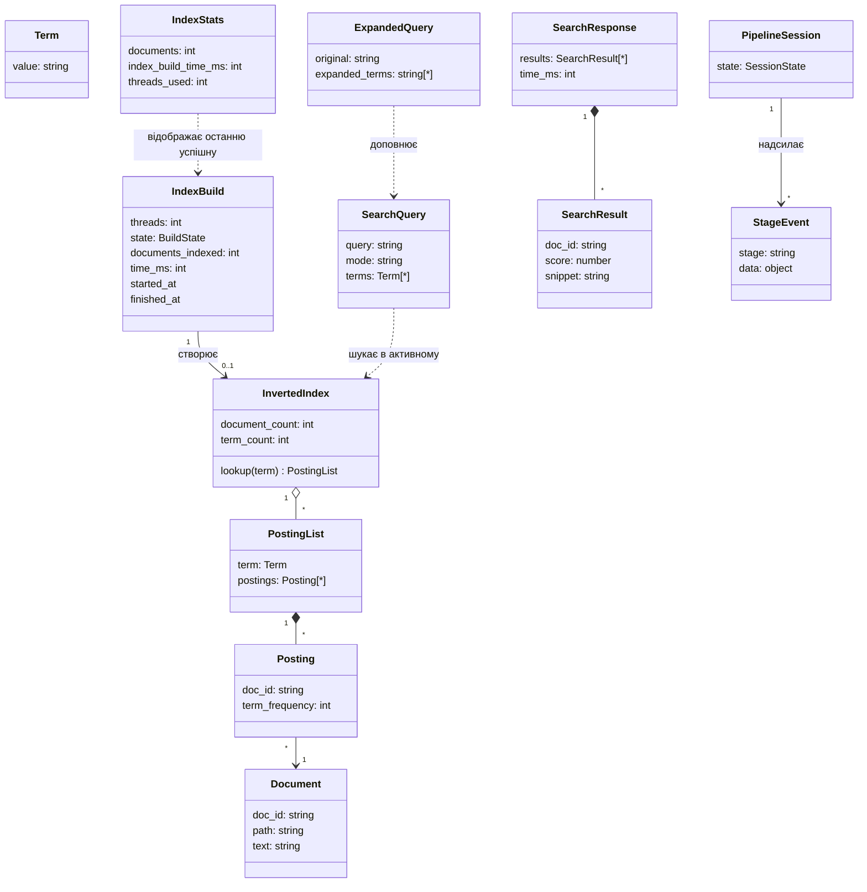
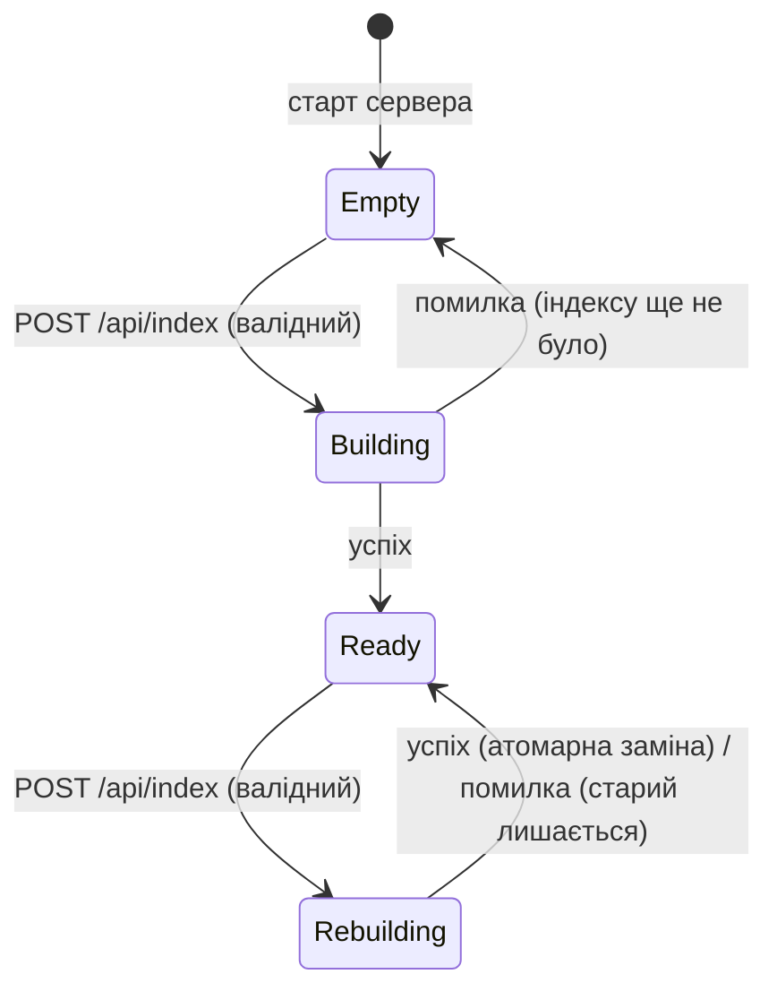

# 07. Доменна модель і контракти даних

Модель логічна: вона визначає поняття, атрибути, інваріанти і стани, а не класи C++ чи структури пам'яті. Конкретне представлення (хеш-таблиці, шардинг, типи контейнерів) вирішується на етапі архітектури через ADR. Бази даних немає: індекс зберігається в пам'яті процесу (OOS-3).

## 1. Сутності

### 1.1. Document
| Атрибут | Тип | Правила |
|---|---|---|
| `doc_id` | string | Унікальний у межах датасету; стабільний між побудовами. Пропозиція: шлях відносно кореня датасету з `/` як роздільником (OQ-18) |
| `path` | шлях файлової системи | Лежить усередині каталогу датасету; символьні посилання поза каталог не обробляються (NFR-021) |
| `text` | string (UTF-8) | Може бути порожнім (тоді документ рахується в `documents_indexed`, але не має постингів, OQ-22) |

Інваріант: один файл = один документ (OQ-18).

### 1.2. Term
| Атрибут | Тип | Правила |
|---|---|---|
| `value` | string | Результат нормалізації: пропозиція — нижній регістр ASCII/Unicode, послідовності літер і цифр; інші символи — роздільники; стоп-слова не видаляються; стемінгу немає (OQ-21). Непорожній |

Інваріант: документи, запити і розширені терміни нормалізуються одним і тим самим правилом.

### 1.3. Posting і PostingList
| Атрибут | Тип | Правила |
|---|---|---|
| `doc_id` | string | Посилання на Document |
| `term_frequency` | integer ≥ 1 | Кількість входжень терма в документі |

Інваріанти: у межах PostingList кожен `doc_id` трапляється не більше одного разу; `term_frequency` дорівнює точній кількості входжень незалежно від кількості потоків (NFR-005). Позиції термів не зберігаються, якщо формула ранжування (OQ-04) або snippet (OQ-05) їх не вимагає — рішення в ADR.

### 1.4. InvertedIndex
Відображення `Term → PostingList` плюс метадані документів, потрібні для ранжування і snippet (довжина документа, шлях).

Обмеження представлення (CON-015, рішення власника): відображення терм → список постингів, самі списки постингів і таблиця документів реалізуються самостійно поверх масивів і/або списків (власна хеш-таблиця з власною хеш-функцією, бакетами і розширенням, або інша власна структура). Готові асоціативні контейнери (`std::unordered_map`, `std::map`, `std::set`, `std::unordered_set` тощо) і сторонні бібліотеки для цього не використовуються. Межі «масиву/списку» — OQ-37.

Стани життєвого циклу активного індексу — див. §2.1. Активним одночасно є не більше одного індексу.

### 1.5. IndexBuild
| Атрибут | Тип | Правила |
|---|---|---|
| `threads` | integer | 1 ≤ threads ≤ `MAX_INDEX_THREADS` |
| `state` | BuildState | §2.2 |
| `documents_indexed` | integer ≥ 0 | Кількість документів, успішно внесених |
| `time_ms` | integer ≥ 0 | Межі вимірювання — FR-005, OQ-20 |

### 1.6. IndexStats
Відображає останню **успішну** IndexBuild; до неї — нулі (FR-011). Атрибути і типи — EP-04.

### 1.7. SearchQuery, ExpandedQuery
- `SearchQuery.query` — вхідний рядок (EP-03 / WS-C-01), `mode` — лише `keyword`.
- `SearchQuery.terms` — нормалізовані терми запиту, без дублікатів.
- `ExpandedQuery.expanded_terms` — нормалізовані терми з Ollama, без дублікатів, без перетину з `SearchQuery.terms`, не більше `MAX_EXPANDED_TERMS` (FR-019).
- Пошукова множина пайплайну WS = `terms ∪ expanded_terms` (FR-020).

### 1.8. SearchResult, SearchResponse
Контракти — EP-03, WS-E-02. Інваріанти: `score` ≥ 0; результати впорядковані за `score` ↓, при рівності — за `doc_id` ↑ (FR-014); кількість ≤ `SEARCH_TOP_K`.

### 1.9. PipelineSession, StageEvent
- PipelineSession — стан однієї WebSocket-сесії (§2.3).
- StageEvent — одне повідомлення з `stage` ∈ {`query_expansion`, `keyword_search`, `done`, `error`} і `data` за схемами 06 §4.4–4.5.

## 2. Стани

### 2.1. Активний індекс сервера

| Стан | Пошук | Побудова | Статистика |
|---|---|---|---|
| Empty | 409 `index_not_ready` | дозволена | нулі |
| Building | 409 `index_not_ready` | 409 `index_build_in_progress` | нулі |
| Ready | активний індекс | дозволена | остання успішна |
| Rebuilding | попередній індекс (FR-035) | 409 `index_build_in_progress` | попередня успішна |

### 2.2. BuildState однієї побудови
`Pending → Running → Succeeded | Failed`. Failed не змінює активний індекс і статистику.

### 2.3. PipelineSession
Див. 06 §4.2: `Idle ⇄ Running`, закриття з будь-якого стану.

## 3. Контракти вводу/виводу

| Контракт | Напрям | Схема |
|---|---|---|
| IndexRequest / IndexResponse | клієнт ⇄ сервер | `openapi.yaml#/components/schemas/IndexRequest`, `IndexResponse` |
| SearchRequest / SearchResponse | клієнт ⇄ сервер | `SearchRequest`, `SearchResponse` |
| HealthResponse, StatsResponse | сервер → клієнт | однойменні схеми |
| ErrorResponse | сервер → клієнт | `ErrorResponse` [P] |
| WS-C-01, WS-E-01…WS-E-04 | WebSocket | `Ws*` схеми в `openapi.yaml`, 06 §4 |
| Ollama generate | сервер ⇄ Ollama | 08 §3 |
| Датасет | файлова система → сервер | каталог UTF-8 текстових файлів (NFR-014, OQ-18, OQ-23) |
| Звіт бенчмарку | скрипт → файл | CSV + графік; поля — NFR-002, NFR-003, NFR-023 |

## 4. Конкурентні міркування (на рівні моделі)

| Спільний ресурс | Читачі | Записувачі | Вимога | Посилання |
|---|---|---|---|---|
| Індекс, що будується | — | робочі потоки пулу | Одночасна вставка без втрат і дублів постингів | NFR-004, NFR-005 |
| Активний індекс | обробники пошуку (REST, WS) | лише атомарна заміна після побудови | Пошук бачить або старий, або новий індекс повністю | FR-008, FR-035 |
| Статистика | обробники `/api/stats` | завершення побудови | Три поля завжди з однієї побудови (узгоджений знімок) | FR-010 |
| Прапорець «побудова триває» | обробники `/api/index`, `/api/search` | обробник `/api/index` | Не більше однієї побудови | FR-009 |
| Черга задач пулу | робочі потоки | потік(и), що подають задачі | Кожна задача виконується рівно один раз; [P, OQ-37] черга — власна структура поверх масиву/списку | NFR-006, FR-037 |
| Внутрішня хеш-таблиця індексу під час розширення (rehash) | робочі потоки побудови | робочі потоки побудови | Розширення не губить і не дублює постинги; синхронізація розширення — в ADR | NFR-004, NFR-005, CON-015 |
| Стан WS-сесії | потік сесії | потік сесії, пайплайн | Події однієї сесії не потрапляють до іншої; не більше одного пайплайну | FR-028, FR-027 |

Конкретний механізм синхронізації кожного ресурсу документується в ADR на етапі архітектури (`.claude/rules/architecture.md` §5).
